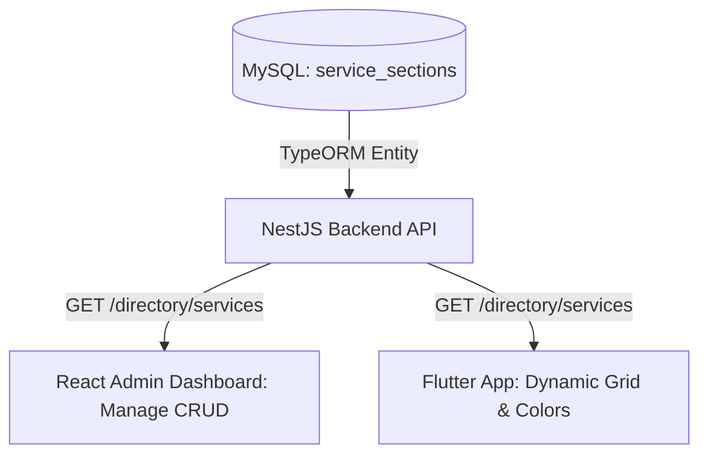

# 📄 SUMMARY_DOCUMENTATION.md | ملخص التوثيق الشامل للتعديلات وتأمين السيرفر

يحتوي هذا المستند على **التوثيق الفني الكامل والتفصيلي** لجميع التعديلات والمهام التي قمنا بتنفيذها لحل المشكلات البرمجية وتأمين خادم التطبيق بالكامل.

---

## 🗺️ الفهرس / Table of Contents
1. [الجزء الأول: نظام تخصيص الخدمات ديناميكياً (Dynamic Services Grid)](#1-dynamic-services-grid)
   * [الهندسة البرمجية للباك إند (NestJS Backend Architecture)](#backend-nestjs)
   * [لوحة التحكم الإدارية (React Admin Dashboard UI)](#admin-dashboard)
   * [تطبيق الهاتف المحمول (Flutter Mobile Integration)](#flutter-mobile)
2. [الجزء الثاني: دليل تأمين وحماية خادم السيرفر (Linux Server Hardening Guide)](#2-server-hardening)
   * [إنشاء المستخدم وتوليد مفاتيح الأمان من نظام Windows](#windows-keys)
   * [تأمين منفذ الـ SSH وجدار الحماية UFW ونظام Fail2ban](#firewall-ssh)

---

<a name="1-dynamic-services-grid"></a>
# 🚀 الجزء الأول: نظام تخصيص الخدمات ديناميكياً (Dynamic Services Grid)

قُمنا باستبدال الأقسام الأربعة الثابتة في الكود (عيادات، رعاية، متجر، تأمين) بنظام متكامل يتيح للمسؤول إدارة الأقسام ديناميكياً من لوحة التحكم، وتحديث التطبيق تلقائياً دون الحاجة لإعادة رفعه للمتاجر.



---

<a name="backend-nestjs"></a>
## 1. الخلفية البرمجية وقاعدة البيانات (NestJS Backend)

### 📂 الملفات التي تم إنشاؤها وتعديلها:
1. **[NEW]** [`service-section.entity.ts`](file:///c:/Users/second%20fictory/Desktop/pet-atlas/pet-atlas/backend/src/modules/directory/entities/service-section.entity.ts):
   * تم تصميم الكيان البرمجي لجدول قاعدة البيانات بالخصائص التالية:
     * `id`: رقم تعريفي فريد تلقائي الزيادة.
     * `titleAr` / `titleEn`: عنوان القسم باللغتين العربية والإنجليزية لدعم التوطين الكامل.
     * `iconName`: اسم الأيقونة كنص (مثل `medical_services`, `content_cut`, `pets`).
     * `baseColor`: كود الألوان بالصيغة السداسية عشريّة (HEX Code مثل `#2196F3`).
     * `listingType`: الفئة البرمجية المطابقة في الدليل البيطري (`Clinic`, `Vet`, `Grooming`, `Shop`, `Insurance`).
     * `isActive`: خيار تفعيل أو إيقاف ظهور القسم في التطبيق بضغطة زر.

2. **[MODIFY]** [`directory.module.ts`](file:///c:/Users/second%20fictory/Desktop/pet-atlas/pet-atlas/backend/src/modules/directory/directory.module.ts):
   * تسجيل الكيان الجديد `ServiceSection` ضمن `TypeOrmModule.forFeature` ليتم التعرف عليه وربطه بقاعدة البيانات.

3. **[MODIFY]** [`directory.service.ts`](file:///c:/Users/second%20fictory/Desktop/pet-atlas/pet-atlas/backend/src/modules/directory/directory.service.ts):
   * بناء دوال الاستعلام والتحكم الكاملة (CRUD):
     * `getServiceSections(onlyActive: boolean)`: لجلب الأقسام.
     * `createServiceSection(dto)`: إضافة قسم جديد.
     * `updateServiceSection(id, dto)`: تحديث تفاصيل قسم موجود.
     * `deleteServiceSection(id)`: حذف قسم نهائياً.
   * **⚠️ ميكانيكية حماية احتياطية (Resilient Fallback System):** قمنا بإضافة نظام حماية ذكي، في حال لم تكن قاعدة البيانات مهيأة أو حدثت هجرة للملفات أثناء تشغيل السيرفر، يقوم السيرفر تلقائياً بإرجاع الأقسام الافتراضية الأربعة الثابتة لضمان عدم توقف التطبيق أو انهياره أبداً.

4. **[MODIFY]** [`directory.controller.ts`](file:///c:/Users/second%20fictory/Desktop/pet-atlas/pet-atlas/backend/src/modules/directory/directory.controller.ts):
   * إنشاء مسارات الـ API وتأمينها:
     * `GET /directory/services`: مسار عام ومفتوح للتطبيق لجلب الأقسام النشطة فقط.
     * `GET /directory/services/admin`: مسار إداري مغلق لجلب كافة الأقسام (النشطة والمعطلة) للوحة التحكم.
     * `POST /directory/services`: مسار إضافة قسم (مؤمن بحارس التحقق للمسؤولين فقط).
     * `PUT /directory/services/:id`: مسار التحديث الإداري.
     * `POST /directory/services/:id/delete`: مسار الحذف الإداري الآمن.

---

<a name="admin-dashboard"></a>
## 2. لوحة التحكم للمسؤول (React Admin Dashboard UI)

قمنا بتصميم واجهة إدارة متكاملة وسلسة تعتمد على تجربة مستخدم بريميوم (Premium UI UX) بخصائص بصرية رائعة.

### 📂 الملفات التي تم إنشاؤها وتعديلها:
1. **[NEW]** [`Services.tsx`](file:///c:/Users/second%20fictory/Desktop/pet-atlas/pet-atlas/dashboard/src/pages/Admin/Services.tsx):
   * واجهة إدارة الأقسام ديناميكياً بستايل كروت تفاعلية ملونة تعكس نفس ألوان وأيقونات الأقسام المدخلة.
   * نموذج منبثق (Modal) حديث ومميز للإضافة والتعديل يحتوي على:
     * مدخلات مخصصة للعناوين باللغتين العربية والإنجليزية.
     * **منتقي الأيقونات (Material Icon Picker)**: يتيح اختيار الأيقونة المناسبة للخدمة مع معاينة حية فورية.
     * **منتقي الألوان (Color HEX Picker)**: يتيح اختيار الألوان بسلاسة تامة.
     * مفتاح تعطيل وتفعيل القسم (`isActive`) لإخفائه مؤقتاً أو إظهاره.
   * اتصال مباشر وذاتي مع خادم NestJS لتطبيق عمليات الإضافة والتعديل والحذف وتحديث البطاقات تلقائياً.

2. **[MODIFY]** [`App.tsx`](file:///c:/Users/second%20fictory/Desktop/pet-atlas/pet-atlas/dashboard/src/App.tsx):
   * تسجيل مسار الصفحة الجديد `/admin/services` تحت نطاق المسارات المؤمنة بـ `<AdminRoute>`.

3. **[MODIFY]** [`AdminLayout.tsx`](file:///c:/Users/second%20fictory/Desktop/pet-atlas/pet-atlas/dashboard/src/components/AdminLayout.tsx):
   * إضافة زر التنقل الجانبي الجديد **"Services Grid"** مع أيقونة منسقة (`grid_view`) وتثبيته في القائمة لتسهيل وصول المسؤولين إليه.

---

<a name="flutter-mobile"></a>
## 3. تطبيق الهواتف الذكية (Flutter Mobile App)

قُمنا بربط التطبيق بالكامل مع المسارات الديناميكية الجديدة، مع ضمان الدعم الكامل للغتين وتفادي الانهيارات.

### 📂 الملفات التي تم إنشاؤها وتعديلها:
1. **[NEW]** [`service_section.dart`](file:///c:/Users/second%20fictory/Desktop/pet-atlas/pet-atlas/lib/features/directory/data/models/service_section.dart):
   * كلاس نموذج البيانات (Data Model) لاستقبال وتحويل بيانات JSON القادمة من الـ API إلى كائنات Dart برمجية بشكل آمن.

2. **[MODIFY]** [`directory_repository.dart`](file:///c:/Users/second%20fictory/Desktop/pet-atlas/pet-atlas/lib/features/directory/data/repositories/directory_repository.dart):
   * إضافة دالة `getActiveServices()` للتواصل مع منفذ الباك إند.
   * **إعداد الدعم الاحتياطي (Offline Fallback)**: في حال انقطاع الإنترنت أو تعذر الوصول للسيرفر، يقوم التطبيق بعرض قائمة محلية افتراضية منسقة للخدمات بدلاً من التوقف أو إظهار شاشة فارغة.

3. **[MODIFY]** [`system_config_cubit.dart`](file:///c:/Users/second%20fictory/Desktop/pet-atlas/pet-atlas/lib/features/directory/bloc/system_config_cubit.dart):
   * تحديث كلاس الحالة `SystemConfigState` لحفظ وتمرير قائمة الأقسام `services` بجانب الإعدادات الأخرى.
   * دمج جلب الخدمات مع إعدادات النظام وتحديث الـ Cubit بشكل فوري متزامن في الخلفية لضمان سرعة التحميل.

4. **[MODIFY]** [`home_screen.dart`](file:///c:/Users/second%20fictory/Desktop/pet-atlas/pet-atlas/lib/features/home/home_screen.dart):
   * استبدال شبكة الـ `GridView.count` الثابتة بـ `GridView.builder` ديناميكية بالكامل.
   * **محلل الألوان والأيقونات ديناميكياً:**
     * دالة `_getColorFromHex` لتحويل الألوان النصية القادمة من السيرفر (مثل `#E3F2FD`) إلى كائنات `Color` حقيقية في Flutter.
     * دالة `_getIconData` لتحليل اسم الأيقونة النصي ومطابقته برمز الأيقونة من مكتبة الأيقونات الرسمية لـ Flutter.
   * **دعم اللغتين تلقائياً**: يقرأ التطبيق لغة النظام والجهاز الحالية، فإذا كانت العربية يعرض الحقل `titleAr` وإذا كانت الإنجليزية يعرض الحقل `titleEn`.
   * تمرير فلتر التوجيه المناسب (`listingType`) عند الضغط على الكرت لفتح قائمة الدليل المناسبة للقسم المختار.

---

<a name="2-server-hardening"></a>
# 🛡️ الجزء الثاني: دليل تأمين وحماية خادم السيرفر (Linux Server Hardening Guide)

في هذا الجزء قمنا بحماية الخادم بالكامل لمنع أي هجمات خارجية عشوائية وتأمين الدخول باستخدام مفتاح التشفير الآمن.

---

<a name="windows-keys"></a>
## 1. توليد مفاتيح الأمان وإعداد المستخدم الجديد من جهازك الشخصي

### 💻 الخطوة أ: توليد مفتاح الأمان على جهازك (Windows PowerShell)

1. افتح نافذة **PowerShell** على جهاز الويندوز وقم بإنشاء مجلد الأمان بجهازك للتأكد من وجوده:
   ```powershell
   New-Item -ItemType Directory -Force -Path "$HOME\.ssh"
   ```
2. قم بتوليد زوج مفاتيح التشفير الآمن وعالي الكفاءة من نوع **ED25519** بداخل المجلد:
   ```powershell
   ssh-keygen -t ed25519 -b 4096 -f "$HOME\.ssh\pet_atlas_server_key"
   ```
   *(اضغط Enter لترك كلمة المرور فارغة أو أدخل كلمة مرور إضافية للمفتاح حسب رغبتك).*

3. اعرض محتوى المفتاح العام لنسخه بالكامل:
   ```powershell
   Get-Content "$HOME\.ssh\pet_atlas_server_key.pub"
   ```
   *انسخ السطر الظاهر بالكامل والذي سيبدأ بـ `ssh-ed25519 ...`.*

---

### 🖥️ الخطوة ب: إعداد المستخدم والمفتاح على السيرفر (بصفتك root)

1. اتصل بالسيرفر الحالي كـ `root` عبر المنفذ الافتراضي 22:
   ```bash
   ssh root@91.99.108.165
   ```
   *(أدخل كلمة المرور الحالية: `55431978541lA@A`)*

2. قم بإنشاء المستخدم الجديد المخصص (`myuser`):
   ```bash
   adduser myuser
   ```
   *(اختر كلمة مرور قوية للمستخدم الجديد واحفظها لديك).*

3. امنح المستخدم الجديد صلاحيات الـ `sudo` الكاملة لتنفيذ أوامر المسؤول:
   ```bash
   usermod -aG sudo myuser
   ```

4. قم بإنشاء مجلد المفاتيح للمستخدم الجديد وادخل لتسجيل المفتاح:
   ```bash
   mkdir -p /home/myuser/.ssh
   nano /home/myuser/.ssh/authorized_keys
   ```
   *الصق المفتاح العام الذي قمت بنسخه من جهاز الويندوز في الخطوة السابقة بداخل الملف.*
   *احفظ الملف عبر الضغط على `Ctrl + O` ثم `Enter`، واخرج بـ `Ctrl + X`.*

5. **تطبيق الصلاحيات الأمنية الصارمة للمجلد والملف (خطوة بالغة الأهمية):**
   ```bash
   chown -R myuser:myuser /home/myuser/.ssh
   chmod 700 /home/myuser/.ssh
   chmod 600 /home/myuser/.ssh/authorized_keys
   ```

---

### 🔌 الخطوة ج: اختبار الدخول بالمفتاح قبل قفل السيرفر

*افتح نافذة PowerShell **جديدة** على جهاز الويندوز وحاول الاتصال باستخدام المفتاح الجديد:*
```powershell
ssh -i "$HOME\.ssh\pet_atlas_server_key" myuser@91.99.108.165
```
* **في حال نجاح الاتصال وتخطي طلب كلمة المرور:** قَد تم ربط جهازك بالمفتاح بنجاح تام! يمكنك الآن المتابعة للتأمين.
* **في حال طلب كلمة المرور أو تعذر الاتصال:** لا تكمل الخطوات التالية وتأكد من تطبيق صلاحيات الملفات واسم المجلد بشكل سليم.

---

<a name="firewall-ssh"></a>
## 2. تغيير المنفذ وإعداد جدار الحماية (UFW) ونظام (Fail2ban) وقفل الـ Root

بمجرد التحقق التام من قدرتك على الدخول بالمستخدم الجديد والمفتاح بنجاح، قم بتنفيذ الخطوات التالية لتأمين الخادم وقفله.

### 🛡️ الخطوة أ: إعداد جدار الحماية (UFW) وتثبيت نظام Fail2ban لحظر المهاجمين

1. **السماح بالمنفذ المخصص الجديد (مثال: 2244) أولاً لتفادي انغلاق السيرفر:**
   ```bash
   sudo ufw allow 2244/tcp
   ```
2. تفعيل جدار الحماية على السيرفر:
   ```bash
   sudo ufw enable
   ```
   *(اضغط `y` للموافقة عند التحذير).*

3. تثبيت أداة **Fail2ban** لمراقبة محاولات الاختراق وحظر عناوين الـ IP للمهاجمين تلقائياً:
   ```bash
   sudo apt update
   sudo apt install fail2ban -y
   ```
4. عمل نسخة احتياطية من ملف الإعدادات للتخصيص:
   ```bash
   sudo cp /etc/fail2ban/jail.conf /etc/fail2ban/jail.local
   sudo nano /etc/fail2ban/jail.local
   ```
   *ابحث عن قسم `[sshd]` وقم بتحديث المنافذ والإعدادات لتطابق التالي:*
   ```ini
   [sshd]
   enabled = true
   port = 2244
   maxretry = 3
   bantime = 1h
   ```
   *احفظ الملف واخرج، ثم أعد تشغيل الخدمة:*
   ```bash
   sudo systemctl restart fail2ban
   ```

---

### 🔒 الخطوة ب: تعديل إعدادات خدمة الـ SSH وقفل الدخول العام

1. افتح ملف إعدادات نظام الـ SSH بالسيرفر للتعديل:
   ```bash
   sudo nano /etc/ssh/sshd_config
   ```
2. ابحث عن الأسطر التالية وقم بتعديلها لتطابق الإعدادات الأمنية القوية التالية (قم بإلغاء علامة `#` في بداية السطور عند الضرورة):
   ```text
   # تغيير منفذ الدخول للمنفذ المخصص الجديد
   Port 2244

   # منع دخول حساب الـ root مباشرة لحماية مطلقة
   PermitRootLogin no

   # إلغاء وإيقاف الدخول بكلمات المرور نهائياً (يتطلب مفتاح تشفير فقط)
   PasswordAuthentication no

   # تحديد الحد الأقصى لمحاولات المصادقة الخاطئة في الاتصال الواحد
   MaxAuthTries 3
   ```
3. احفظ الملف واخرج (`Ctrl+O` ثم `Enter` ثم `Ctrl+X`).
4. أعد تشغيل خدمة الـ SSH لتطبيق التغييرات الأمنية فوراً:
   ```bash
   sudo systemctl restart ssh
   ```

---

### 🎯 النتيجة النهائية للاتصال بالسيرفر مستقبلاً:
من الآن فصاعداً، لن يتمكن أي شخص من الاتصال بالسيرفر عبر حساب الـ `root` أو استخدام كلمات المرور العشوائية، وسيتم الاتصال حصراً من جهازك الشخصي الموثق بالمفتاح عبر الأمر التالي:
```powershell
ssh -i "$HOME\.ssh\pet_atlas_server_key" -p 2244 myuser@91.99.108.165
```

---
> **[!NOTE]**
> لقد تم إنشاء وحفظ نسخة دائمة من هذا التوثيق الفني باللغتين العربية والإنجليزية داخل مجلد مشروعك تحت الاسم:
> [server_hardening_and_customization_documentation.md](file:///c:/Users/second%20fictory/Desktop/pet-atlas/pet-atlas/server_hardening_and_customization_documentation.md)
