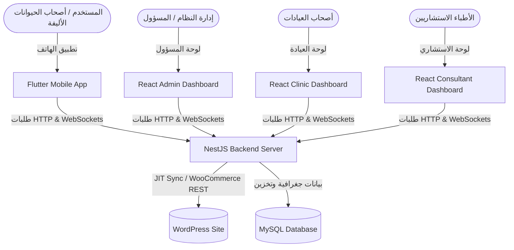
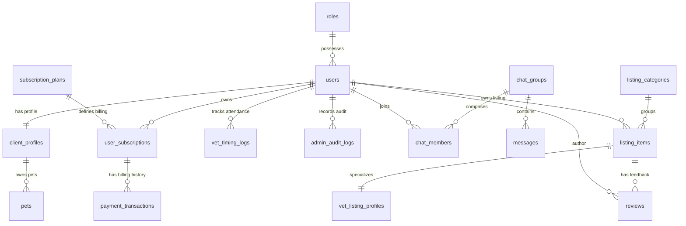

# دليل معمارية وبنية مشروع Pet-Atlas (Ecosystem Architectural Guide)

هذا الدليل الفني يوثق بنية المعمارية المتكاملة لمشروع **Pet-Atlas**، وهو نظام بيئي هجين (Hybrid SaaS Ecosystem) يخدم أصحاب الحيوانات الأليفة، الأطباء البيطريين، والعيادات. يوضح هذا المستند تفاصيل الربط بين WordPress وخادم NestJS، وتصميم قاعدة البيانات، والمنصات والتطبيقات المرتبطة.

---

## 🏛️ 1. المفهوم العام للنظام (System Design Concept)

يعمل نظام **Pet-Atlas** كجسر مزامنة عالي الأداء يربط بين موقع إدارة المحتوى **WordPress** وسيرفر المعالجة الفورية **NestJS**:



### 💡 فلسفة التصميم الهجين:
1. **الهوية الموحدة (Single Source of Truth)**: يعتبر موقع WordPress هو المصدر الأساسي للحسابات المسجلة.
2. **فصل المهام الثقيلة (Task Offloading)**: يُحوّل الحمل الحسابي والعمليات الفورية (مثل محادثات WebSockets وحسابات المسافات الجغرافية والاشتراكات الفورية وتجديدها) إلى خادم NestJS المصمم لمعالجة آلاف الطلبات المتزامنة.

---

## 💾 2. بنية قاعدة البيانات وعلاقاتها (`create_tables.sql`)

صُممت قاعدة البيانات في MySQL لتوفير أقصى درجات الأداء عند معالجة البيانات الجغرافية والعمليات البرمجية الكثيفة:

### 📊 المخطط الهيكلي لقاعدة البيانات (Entity Relationship Model)



### 🔑 تفاصيل الجداول المميزة:
* **جدول `users`**: يطابق معرّف الحساب تلقائياً مع معرّف ووردبريس (`wp_users.ID`) بدقة لتسهيل المزامنة الفورية.
* **جدول `messages` (التقسيم الزمني - Partitioning)**:
  قُسّم جدول الرسائل زمنياً (Range Partitioning) بناءً على سنة الإنشاء `created_at` لتحسين سرعة القراءة والكتابة للرسائل (نفس الأسلوب المتبع في التطبيقات الكبيرة كـ WhatsApp):
  ```sql
  PARTITION BY RANGE (UNIX_TIMESTAMP(created_at)) (
      PARTITION p_2025 VALUES LESS THAN (UNIX_TIMESTAMP('2026-01-01 00:00:00')),
      PARTITION p_2026 VALUES LESS THAN (UNIX_TIMESTAMP('2027-01-01 00:00:00')),
      PARTITION p_future VALUES LESS THAN MAXVALUE
  );
  ```
* **جدول `listing_items` (المسافات الجغرافية - Spatial Types)**:
  يستخدم الحقل `coordinates` بنوع البيانات الجغرافي **`POINT`** مع فهرس جغرافي مخصص **`SPATIAL INDEX`** لضمان حساب المسافات فورياً ودون أي حمل على المعالج.

---

## ⚙️ 3. خدمات خادم NestJS الخلفية (NestJS Backend Services)

تم تقسيم منطق الأعمال في الخلفية إلى موديولات مستقلة ومترابطة بشكل مرن:

### 🔑 موديول المصادقة والمزامنة (`Auth Module`)
* **الملف الرئيسي**: `backend/src/modules/auth/auth.service.ts`
* **آلية المزامنة الفورية (JIT Sync)**:
  1. يقوم المستخدم بإدخال بياناته في التطبيق، فيتصل خادم NestJS بواجهة WordPress للحصول على التوكن: `${wpBaseUrl}/wp-json/jwt-auth/v1/token`.
  2. في حال المصادقة بنجاح، يُمرر التوكن إلى الدالة `syncUserProfile` التي تقوم بفحص قاعدة البيانات المحلية؛ إذا لم يكن المستخدم موجوداً، يتم provision لحساب محلي يطابق معرّف ووردبريس وتعيين الصلاحيات تلقائياً بناءً على رتب ووردبريس (Client, Vet, Admin).
  3. يتم تفعيل المحادثة الرسمية التلقائية للدعم البيطري (`ensureOfficialChat`) وتعيين الاستشاريين أعضاءً بها فوراً.

### 📍 موديول الدليل الجغرافي (`Directory Module`)
* **الملف الرئيسي**: `backend/src/modules/directory/directory.service.ts`
* **البحث بنصف القطر الجغرافي (Radial Spatial Lookup)**:
  يستخدم الدالة الرياضية `ST_Distance_Sphere` لحساب المسافة الدقيقة بالمتر بين موقع العميل ومواقع العيادات البيطرية مباشرة عبر قاعدة البيانات:
  ```typescript
  query.addSelect(`ST_Distance_Sphere(listing.coordinates, POINT(${userLat}, ${userLon}))`, 'listing_distance')
       .having('listing_distance <= :radius', { radius });
  ```
* **الميزات**:
  * تصفية النتائج حسب تصنيف المنشأة (`Clinic`, `Vet`, `Grooming`, etc.).
  * تصفية النتائج بناءً على الحسابات الرسمية الموثقة `isOfficial` ونطاقات الأسعار.
  * إدارة أعضاء الفريق وإسناد الأطباء للعيادات.

### 💳 موديول الاشتراكات والدفع (`Subscription Module`)
* **الملف الرئيسي**: `backend/src/modules/subscription/subscription.service.ts`
* **دورة حياة الاشتراك المالي**:
  1. **إنشاء الطلب**: عند اختيار باقة الاستشارات (بقيمة 38 درهم)، يقوم النظام بإنشاء طلب دفع عبر ووكومرس (`POST /wp-json/wc/v3/orders`) مع تمرير معرّف الباقة وبوابة دفع MyFatoorah.
  2. **رابط الدفع**: يتم إرجاع رابط الدفع `paymentUrl` للتطبيق لتسهيل إتمام العملية ماليًا.
  3. **تأكيد الدفع**: عند تأكيد العملية، يقوم السيرفر بتعديل حالة الطلب في ووردبريس إلى مكتمل `completed` وتفعيل الاشتراك محلياً لمدة 30 يوماً.
  4. **التجديد التلقائي (Auto-Renewal)**: دالة `processAutoRenewals()` يتم تشغيلها عبر مهام Cron مجدولة، وتقوم تلقائياً بتجديد الاشتراكات النشطة وتحديث صلاحية الفترات.
  5. **التخطي الإداري (Admin Bypass)**: يتيح ميزات `forceActivateSubscription` و `forceCancelSubscription` للمسؤولين لتجاوز أو تفعيل الاشتراكات يدوياً دون دفع حقيقي للطلبات الخاصة أو الاستثنائية.

### 💬 موديول المحادثات الفورية والتحكم البيطري (`Chat Module`)
* **الملف الرئيسي**: `backend/src/modules/chat/chat.service.ts` و `chat.gateway.ts`
* **نظام الاستحواذ الحصري للاستشارات (Claiming System)**:
  عندما يرسل المستخدم استشارة جديدة، تُدرج في قائمة الاستشارات العامة غير المحجوزة.
  * بمجرد قيام طبيب استشاري (رتبة 2) بإرسال أول رسالة استجابة للغرفة، يُفعل السيرفر عملية الاستحواذ:
  ```typescript
  await this.groupRepository.query(
    'UPDATE chat_groups SET claimed_by = ?, claimed_at = NOW() WHERE id = ?',
    [userId, groupId]
  );
  ```
  * فور حجز الغرفة للاستشاري، يتم تنظيف الغرفة برمجياً وحذف جميع الاستشاريين الآخرين من قائمة الأعضاء (`chat_members`) لمنع إرسال أي رسائل أخرى من غيره وحماية للخصوصية.
* **إدارة الجلسات والأرشفة**:
  يستطيع الاستشاري أو المدير إنهاء الجلسة الاستشارية وأرشفتها (`archiveChat`)؛ مما يوقف الاتصال ويبث حدث `chatArchived` للتطبيق لإعلام العميل بإغلاق الجلسة بشكل رسمي. وفي حال رغب ببدء استشارة جديدة، يتم توفير غرفة وجلسة برمجية جديدة تماماً.
* **المزايا التفاعلية**: إرسال مؤشرات الكتابة `typing` واستلام مؤشرات المشاهدة والseen للمحادثات فوريًا عبر الـ WebSockets.

### 📰 موديول المزامنة للمدونات (`Blog Module`)
* **الملف الرئيسي**: `backend/src/modules/blog/blog.service.ts`
* **مزامنة التنبيهات مع المقالات الجديدة**:
  يقوم بطلب المقالات دورياً من موقع WordPress، ويصنفها ديناميكياً حسب الفئات لفرزها وعرضها بناءً على نوع الحيوان (كلب، قطة، حيوانات نادرة). وبمجرد استيراد مقال جديد، يقوم النظام تلقائياً بنشر إعلان إخباري فوري داخل قناة الإعلانات العامة بالدردشة لإشراك جميع العملاء.

---

## 📱 4. معمارية تطبيق الهاتف المحمول (Flutter Mobile App)

يتبع التطبيق هيكلية **Clean Architecture** مع تقسيم واضح للملفات والمهام:

```text
lib/
├── core/                  # الأدوات المشتركة والتهيئة
│   ├── config/            # ملفات البيئة وعناوين الخوادم (Environment)
│   ├── network/           # عملاء الشبكات والربط (ApiClient & SocketService)
│   └── theme/             # الألوان والخطوط المشتركة للتطبيق (AppColors)
└── features/              # المودولات والميزات البرمجية المستقلة
    ├── auth/              # تسجيل الدخول والمزامنة (BLoC & WebViews)
    ├── chat/              # واجهات غرف الدردشة بأسلوب الواتساب (BLoC & Screen)
    ├── directory/         # تصفية العيادات والبحث الجغرافي
    ├── home/              # شاشة الإشعارات والمحتويات الأساسية
    └── profile/           # الحساب وملفات الحيوانات الأليفة
```

### 🛰️ عميل الشبكة الفوري (API Client & WebSockets):
1. **الـ ApiClient المزدوج (`lib/core/network/api_client.dart`)**:
   ينقسم عميل Dio الشبكي إلى قسمين:
   * `WpApiClient`: يتصل مباشرة بعنوان `wpBaseUrl` (لشؤون المقالات والتوثيق المبدئي).
   * `LocalApiClient`: يتصل بعنوان `localBaseUrl` الخاص بـ NestJS (للاستعلامات والملفات والدردشات).
2. **بوابة الاتصال الفوري (`lib/core/network/socket_service.dart`)**:
   تتصل البوابة بخادم NestJS عبر `socket_io_client` مستخدمة توكن التوثيق المشفر. تقوم البوابة بفك تشفير التوكن ديناميكياً لتأكيد هوية العميل، وتحول أحداث الـ WebSockets الواردة للرسائل الجديدة، وحالات الكتابة، والقراءة والأرشفة إلى **Streams تفاعلية** يُصغى إليها برمجياً بواسطة موديولات الواجهة.

### 🎨 شاشة المحادثة الاستشارية (`ChatRoomScreen`):
* تدعم إرسال النصوص، والصور (عبر الكاميرا والمعرض)، والفيديوهات، والملفات، والتسجيل الصوتي المباشر باستخدام حزمة `record`.
* تعرض قوالب فقاعات دردشة مخصصة ومصممة لكل نوع من الوسائط مع مؤشرات حالة القراءة المزدوجة (Seen receipts).
* شريط أرشفة مخصص يعطل إرسال الرسائل فور إغلاق الجلسة استشارياً.

---

## 💻 5. الأنظمة واللوحات الإلكترونية للويب (React Dashboards)

يتكون نظام الويب للمشروع من ثلاثة لوحات تحكم مبنية بتقنيات React و TypeScript و Vite:

### 🛡️ 1. لوحة تحكم المسؤول العام (`dashboard`)
مخصصة لإدارة النظام بالكامل ومراقبة الأداء:
* **شاشة الرقابة الفورية (`Monitor.tsx`)**: تتيح للمسؤولين والإدارة العليا الدخول وقراءة الدردشات الجارية بين الأطباء البيطريين وأصحاب الحيوانات لمتابعة الجودة والرقابة المهنية.
* **إدارة الحضور والانصراف**: استعراض سجلات دخول وخروج الاستشاريين والتزامهم بالنوبات.
* **لوحة الاشتراكات (`Subscriptions.tsx`)**: تفعيل الباقات مجاناً أو إلغائها وتعديل صلاحيتها تجاوزاً للنظام المالي يدوياً.
* **إدارة الدليل الجغرافي والمدونات والمستخدمين وصلاحياتهم**.

### 🏥 2. لوحة تحكم العيادات البيطرية (`clinic-dashboard`)
بوابة مخصصة لمسؤولي العيادات والمنشآت المدرجة:
* **تخصيص البيانات التعريفية للعيادة (`ListingProfile.tsx`)**: رفع الشعار، الصور، الخدمات الطبية المتاحة، الأجهزة والأسعار، وساعات العمل.
* **إدارة الحجوزات المباشرة (`Bookings.tsx`)**: قبول أو رفض مواعيد زيارات العملاء والعمليات الطبية وإكمالها وتحديث حالتها.
* **إدارة شؤون الموظفين البيطريين (`TeamManagement.tsx`)**: إضافة أو إزالة الأطباء المساعدين لربطهم بالملف العام للعيادة للرد على الحالات.

### 🩺 3. لوحة الطبيب الاستشاري (`consultant-dashboard`)
صندوق البريد المخصص لاستقبال استشارات الحيوانات الأليفة:
* **مركز الدردشة والرد المباشر (`ChatHub.tsx`)**: يستعرض الاستشارات العامة المعلقة للحيوانات؛ عند النقر على محادثة غير مستحوذ عليها، يتم حجزها للطبيب فوراً للبدء بتقديم الرعاية الطبية الفورية بأسلوب الواتساب (نص، صوت، فيديو).
* **إدارة جدول المواعيد والعمليات وأوقات التواجد الاستشاري**.

---

## 🏁 6. خلاصة وفهم البنية البرمجية المتكاملة
يُعد نظام **Pet-Atlas** تطبيقاً مميزاً على مستوى الهندسة البرمجية وتصميم الأنظمة الكبيرة والهجينة؛ حيث يربط بين سرعة وقوة WebSockets والمحركات الجغرافية الفورية في NestJS لتجاوز قيود ووردبريس، مع الحفاظ على ووردبريس كنظام موحد للمستخدمين والاشتراكات. البنية البرمجية للتطبيقات واللوحات تدعم التوسع الفوري للخدمات دون أي حاجة لإعادة بناء المعمارية البرمجية الأساسية.
